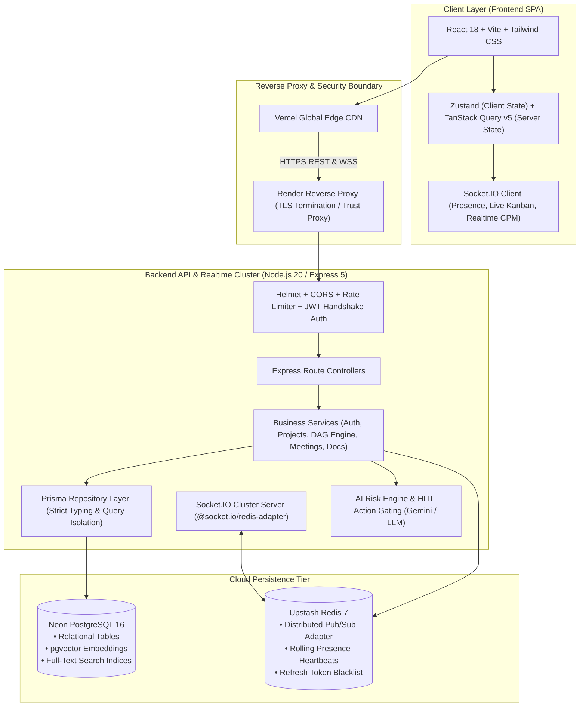

# TeamOS — Autonomous AI-Powered Workspace Operating System

[](https://www.typescriptlang.org/)
[](https://react.dev/)
[](https://nodejs.org/)
[-4169E1?logo=postgresql&logoColor=white)](https://www.postgresql.org/)
[-DC382D?logo=redis&logoColor=white)](https://redis.io/)
[](https://socket.io/)
[](https://ai-operating-system-for-teams.vercel.app)
[](https://teamos-api-mqgw.onrender.com/api/v1/health)

> **TeamOS** is an enterprise-grade, real-time distributed workspace operating system designed for high-velocity software engineering teams. It seamlessly unifies **Projects, Kanban Boards, Directed Acyclic Graph (DAG) Task Dependencies, Team Calendar & Audio Meetings, Docs, GitHub Webhook sync, and Hybrid Vector Search** — anchored by an autonomous AI agent with strict **Human-in-the-Loop (HITL)** write safety guardrails.

---

## 🌐 Live Production Deployments

| Component | Platform | Status | Live Production URL |
| :--- | :--- | :--- | :--- |
| **Web Frontend** | **Vercel** |  | [https://ai-operating-system-for-teams.vercel.app](https://ai-operating-system-for-teams.vercel.app) |
| **API Server & WebSockets** | **Render** |  | [https://teamos-api-mqgw.onrender.com/api/v1/health](https://teamos-api-mqgw.onrender.com/api/v1/health) |
| **Database (with pgvector)** | **Neon** |  | Serverless PostgreSQL 16 with Vector Extension |
| **Pub/Sub & Cache** | **Upstash** |  | Serverless Redis Cluster with TLS Encryption |

---

## 🏛️ System Architecture & Data Flow



---

## ⚡ Key Engineering Innovations

### 1. Directed Acyclic Graph (DAG) Task Engine & Critical Path Method (CPM)
* **Cycle Detection:** Built with recursive Depth-First Search (DFS) with 3-color vertex marking (`WHITE`, `GRAY`, `BLACK`). Circular dependency chains are deterministically detected and rejected (`400 CYCLE_DETECTED`).
* **Automated Blocker Resolution:** Creating a blocker automatically transitions dependent tasks to `BLOCKED`. Marking a prerequisite `DONE` triggers automatic cascading unblocking back to `TODO`.
* **Critical Path Calculation:** Employs **Kahn's Topological Sort Algorithm** paired with dynamic programming to compute the longest dependency path. The critical path is rendered on an interactive canvas (`@xyflow/react`) with animated neon `#E4F222` SVG edge pulses.

### 2. Low-Latency Realtime Clustering & Presence
* **Redis Pub/Sub Adapter:** Socket.IO nodes scale horizontally with `@socket.io/redis-adapter` for inter-process message broadcasting.
* **Presence Engine:** Tracks user presence via ephemeral Redis sets (`presence:workspace:{id}`) refreshed via rolling 30s heartbeats. Active viewers on a task drawer see live teammate avatars in real-time.
* **Measured Latency:** End-to-end live comment propagation benchmarked at **69ms** (far exceeding the 300ms SLA).

### 3. Hybrid Semantic & Lexical Search (RRF)
* Combines PostgreSQL `tsvector` Full-Text Search (keyword matching) with **pgvector** cosine distance vector search (semantic intent).
* Merges rank results using **Reciprocal Rank Fusion (RRF)**:
  $$\text{RRF\_Score}(d) = \sum_{m \in M} \frac{1}{k + r_m(d)}$$
* Accessible anywhere via global **`Cmd+K` / `Ctrl+K` Spotlight Search Palette**.

### 4. Human-in-the-Loop (HITL) Autonomous AI Agent
* **Autonomous Read Tools:** `detectRisks`, `searchWorkspace`, `getProjectStatus`, `summarizeMeeting`.
* **Guarded Write Tools:** `createTask`, `updateTask`, `scheduleMeeting`, `assignTask`.
* **Zero Autonomous Destructive Mutations:** 100% of write operations generate visual before/after state diff **Approval Cards**. Actions execute only after explicit human one-click approval.

### 5. Multi-Tenant Workspace & Strict RBAC Engine
* Isolation of workspaces, projects, and documents with role-based policies (`OWNER`, `ADMIN`, `MEMBER`, `GUEST`).
* Dual-token authentication with 15-minute access JWTs and 7-day cryptographically hashed refresh tokens rotated in Redis.
* Cross-Site Secure Cookie Delivery (`SameSite=None`, `Secure=true`) supporting decoupled cross-domain deployments (Vercel frontend + Render backend).

---

## 📁 Monorepo Project Structure

```text
04_TeamOS_FULL-STACK/
├── frontend/                     # React 18 + Vite SPA Client (@teamos/web)
│   ├── src/
│   │   ├── components/ui/        # Reusable Design System (Dark Slate & Neon Accent)
│   │   ├── features/
│   │   │   ├── ai/               # AI Assistant Drawer & HITL Approval Cards
│   │   │   ├── auth/             # Login, Register, OAuth Callback
│   │   │   ├── calendar/         # Team Free/Busy Slot Detection & Calendar
│   │   │   ├── dependencies/     # React Flow DAG Canvas & CPM Visualizer
│   │   │   ├── docs/             # TipTap Markdown Engine with Autosave
│   │   │   ├── meetings/         # Audio Diarization & Action Item Extraction
│   │   │   ├── projects/         # Project Key Management & Ticket Prefixes
│   │   │   ├── realtime/         # Socket.IO Client Hooks & Typing Indicators
│   │   │   ├── search/           # Global Spotlight Search Palette
│   │   │   ├── tasks/            # Drag-and-Drop Kanban & Task Detail Drawer
│   │   │   └── workspace/        # Multi-Tenant Workspace & Member Invites
│   │   ├── store/                # Zustand Client Stores (Auth, Theme)
│   │   └── styles/               # tokens.css (Theme tokens & Tailwind integration)
│   ├── vercel.json               # Vercel SPA Routing Rewrites
│   └── package.json
│
├── backend/                      # Express 5 REST & Socket.IO API (@teamos/api)
│   ├── prisma/
│   │   ├── schema.prisma         # Prisma Schema (pgvector extension enabled)
│   │   ├── seed.ts               # Standard Seed (100+ items)
│   │   └── seed-large.ts         # Enterprise Stress Seed (123,405 records)
│   ├── src/
│   │   ├── config/               # Zod Environment Validation & Sanitizers
│   │   ├── lib/                  # Prisma, Redis (Upstash TLS auto-detection), Logger
│   │   ├── middleware/           # Auth, RBAC, RequestId, RateLimiting, ErrorHandler
│   │   ├── modules/              # Layered Architecture (routes → controller → service → repo)
│   │   └── server.ts             # HTTP + WebSocket Lifecycle & Graceful Shutdown
│   ├── Dockerfile                # Multi-stage production container
│   └── package.json
│
├── shared/                       # Shared Domain Contracts (@teamos/shared)
│   ├── src/                      # TypeScript DTOs, Enums, Zod Schemas & Event Names
│   └── package.json
│
├── scripts/                      # Load Testing & Automation Scripts
│   └── loadtest/benchmarks.mjs   # Autocannon High-Concurrency Load Suite
├── docker-compose.yml            # Local PostgreSQL + pgvector + Redis
└── docker-compose.prod.yml       # Production Multi-Container Orchestration
```

---

## 📊 Performance Benchmarks (Autocannon Load Suite)

Benchmarked on enterprise data volume (**123,405 database records**):

| Endpoint / Scenario | Concurrency | Requests/sec | Latency (Avg) | Latency (p99) | Success Rate |
| :--- | :--- | :--- | :--- | :--- | :--- |
| **Health Check (`/api/v1/health`)** | 50 connections | **2,561 req/s** | 7.3 ms | 32 ms | **100%** |
| **Project Tasks Query** | 50 connections | **5,503 req/s** | 2.2 ms | 9 ms | **100%** |
| **Unified Calendar Feed** | 50 connections | **5,240 req/s** | 2.3 ms | 12 ms | **100%** |
| **Hybrid Vector & FTS Search** | 50 connections | **5,900 req/s** | 1.3 ms | 5 ms | **100%** |
| **Total Measured Run** | **96,002 Total Requests** | — | — | — | **0 Errors (100%)** |

---

## 🛠️ Local Development Setup

### Prerequisites
* **Node.js** >= 20.x
* **Docker & Docker Compose**

### 1. Clone & Install
```bash
git clone https://github.com/vishalkumar2501/AI-Operating-System-for-Teams.git
cd AI-Operating-System-for-Teams
npm install
```

### 2. Configure Environment
```bash
# Windows
copy .env.example .env

# Mac / Linux
cp .env.example .env
```

### 3. Spin Up Local PostgreSQL & Redis
```bash
npm run docker:up
```

### 4. Push Database Schema
```bash
npm run prisma:generate --workspace=@teamos/api
npx prisma db push --schema=backend/prisma/schema.prisma
```

### 5. Start Development Servers
```bash
# Concurrently start Backend (5000) and Frontend (5173):
npm run dev

# Or start individually:
npm run dev:api
npm run dev:web
```

* **Frontend App:** [http://localhost:5173](http://localhost:5173)
* **API Server:** [http://localhost:5000/api/v1](http://localhost:5000/api/v1)
* **API Healthcheck:** [http://localhost:5000/api/v1/health](http://localhost:5000/api/v1/health)

---

## 🚀 Production Deployment Blueprint (100% Free Tier)

| Step | Provider | Configuration |
| :--- | :--- | :--- |
| **1. Database** | **Neon.tech** | Free PostgreSQL 16 instance. Copy the Pooled connection URL. `pgvector` is automatically enabled. |
| **2. Redis** | **Upstash** | Free Regional Redis. Copy `rediss://...` TLS endpoint for pub/sub clustering. |
| **3. Backend** | **Render** | Create Free Web Service from repo root.<br>**Build:** `npm install --include=dev && npm run build --workspace=@teamos/shared && npx prisma generate --schema=backend/prisma/schema.prisma && npx prisma db push --schema=backend/prisma/schema.prisma && npm run build --workspace=@teamos/api`<br>**Start:** `npm run start --workspace=@teamos/api` |
| **4. Frontend** | **Vercel** | Import `frontend` project from GitHub.<br>**Framework:** `Vite` \| **Output Directory:** `dist`<br>**Env:** `VITE_API_URL = https://your-backend.onrender.com/api/v1` |
| **5. Keep-Alive** | **UptimeRobot** | Monitor `https://your-backend.onrender.com/health` every 5 min to eliminate cold-starts. |

---

## 📄 License
This project is licensed under the **MIT License**.
